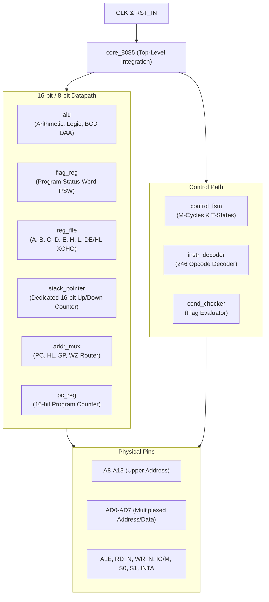

# Intel 8085 Microprocessor RTL Core

[](https://github.com/soumajit-m/8085-microprocessor-rtl/actions/workflows/ci.yml)


A fully synthesizable, cycle-accurate RTL implementation of the classic **Intel 8085 8-bit microprocessor** written in Verilog-2001. This core supports the complete 8085 instruction set (all 246 valid opcodes), authentic multi-cycle execution, physical bus multiplexing (`AD0-AD7` with `ALE` strobe), 16-bit register pair datapaths, decimal adjustment (`DAA`), and complete stack frame subroutines (`CALL`/`RET`, `PUSH`/`POP`).

---

## Technical Specifications

| Feature | Specification |
| :--- | :--- |
| **Data Bus** | 8-bit bidirectional multiplexed bus (`AD0-AD7`) |
| **Address Bus** | 16-bit total: `A8-A15` dedicated upper, `AD0-AD7` multiplexed lower |
| **Addressable Space** | 64 KB memory (`0x0000 - 0xFFFF`) & 256 I/O ports (`0x00 - 0xFF`) |
| **Instruction Set** | Complete 8085 ISA (all 246 opcodes decoded and executed) |
| **Control Unit** | Multi-cycle machine-cycle FSM (`M_FETCH`, `M_MEM_RD`, `M_MEM_WR`, `M_IO_RD`, `M_IO_WR`, `M_HALT`, `M_INTA`) |
| **Hardware Emulation** | True `ALE` address latching, active-low `rd_n`/`wr_n`, status pins `s0`, `s1`, `io_m` |
| **Synthesizable Targets** | Xilinx 7-Series/UltraScale+ (Vivado), Intel Cyclone/MAX (Quartus), ASIC |

---

## System Architecture



* Detailed microarchitecture and timing documentation: **[docs/architecture.md](docs/architecture.md)**.
* Verification plan and testbench specifications: **[docs/verification.md](docs/verification.md)**.

---

## Directory Structure

```
8085-microprocessor-rtl/
├── .github/
│   └── workflows/
│       └── ci.yml               # Automated GitHub Actions regression CI
├── docs/
│   ├── architecture.md          # Complete microarchitecture & timing specification
│   └── verification.md          # Verification methodology & test suite reference
├── scripts/
│   ├── run.sh                   # Linux/macOS simulation regression runner
│   ├── run.ps1                  # Windows PowerShell simulation regression runner
│   ├── synth.tcl                # Xilinx Vivado non-project synthesis script
│   └── sim.tcl                  # Xilinx Vivado batch behavioral simulation script
├── src/
│   ├── addr_mux.v               # 16-bit Address multiplexer
│   ├── alu.v                    # 8-bit ALU with DAA and extended carry logic
│   ├── cond_checker.v           # Branch condition evaluator
│   ├── control_fsm.v            # Cycle-accurate machine cycle & T-state sequencer
│   ├── core_8085.v              # Top-level integration & tri-state AD bus controller
│   ├── flag_reg.v               # Status register & Program Status Word (PSW)
│   ├── instr_decoder.v          # Complete 246 opcode combinational decoder
│   ├── reg_file.v               # Register file with 16-bit pointer math & XCHG
│   └── stack_pointer.v          # Dedicated 16-bit UP/DOWN stack counter
├── testbench/
│   ├── tb_core_basic.v          # 8-bit datapath & basic ALU tests
│   ├── tb_core_16bit.v          # 16-bit pointer math, LXI, DAD, INX, SHLD
│   ├── tb_core_stack_branch.v   # Subroutines, CALL, RET, PUSH, POP, conditional jumps
│   ├── tb_core_sys_io.v         # Hardware I/O ports (IN/OUT) & accumulator specials
│   └── tb_core_advanced.v       # SP pair arithmetic, DAD SP, XCHG, PCHL, DAA, PUSH/POP PSW
├── run.sh                       # Quick-run shell script (wrapper)
├── run.ps1                      # Quick-run PowerShell script (wrapper)
├── .gitignore                   # Comprehensive FPGA & EDA ignore patterns
├── LICENSE.txt                  # MIT License
└── Readme.md                    # Project documentation
```

---

## Simulation & Verification

All testbenches are **self-checking** and validate core execution against a simulated 74LS373 transparent address latch emulator and 64KB SRAM array.

### Available Test Suites

1. **`tb_core_basic`:** Tests `MVI`, `MOV`, `ADD`, `SUB`, `INR`, `DCR`, `ANA`, `HLT`.
2. **`tb_core_16bit`:** Tests `LXI`, `DAD`, `INX`, `SHLD` boundary writes.
3. **`tb_core_stack_branch`:** Tests loops, `JNZ` (taken and not-taken), `CALL`, `RET`, `PUSH`, `POP`.
4. **`tb_core_sys_io`:** Tests `STC`, `CMC`, `CMA`, `RLC`, `OUT` (port 1), `IN` (port 2).
5. **`tb_core_advanced`:** Tests `LXI SP`, `INX SP`, `DCX SP`, `DAD SP`, `XCHG`, `PCHL`, `DAA`, `PUSH PSW`, `POP PSW`.

---

## FPGA Hardware Synthesis Results (Vivado 2025.2 on Artix-7)

The core is 100% self-contained and synthesizable directly without external wrappers, providing exact silicon resource utilization and timing closure on AMD/Xilinx FPGAs:

* **Target Device:** AMD/Xilinx Artix-7 (`xc7a35tcpg236-1`, Digilent Basys 3 target)
* **Top-Level Module:** `core_8085` (Direct Out-of-Context IP Core Synthesis)
* **Synthesis Tool:** AMD Vivado v2025.2 (64-bit)

| Metric | Measured Value | Device Available | Utilization |
| :--- | :--- | :--- | :--- |
| **Slice LUTs** | **958** | 20,800 | **4.61%** |
| **Slice Registers (FFs)** | **141** | 41,600 | **0.34%** |
| **Bonded IOBs** | **26** | 106 | **24.53%** |
| **Latches Inferred** | **0** | — | **0.00% (100% Synchronous)** |
| **Block RAM / DSP Blocks** | **0** | — | **0.00% (Pure Soft Core)** |
| **Critical Path Delay** | **13.942 ns** | — | — |
| **Maximum Frequency ($F_{max}$)** | **~71.72 MHz** | — | **>14× faster than physical 8085A-2 (5 MHz)** |

---

## Getting Started

### Prerequisites

* **Simulation:** [Icarus Verilog](https://bleyer.org/icarus/) (`iverilog`, `vvp`) & [GTKWave](http://gtkwave.sourceforge.net/)
* **Synthesis / Implementation:** [Xilinx Vivado](https://www.xilinx.com/products/design-tools/vivado.html) or [Intel Quartus Prime](https://www.intel.com/content/www/us/en/software/programmable/quartus-prime/overview.html)

### Running Simulations

#### On Linux / macOS / Git Bash:
```bash
# Make the scripts executable
chmod +x scripts/run.sh run.sh

# Run the complete regression suite (all 5 testbenches)
./scripts/run.sh all

# Or run an individual testbench
./scripts/run.sh tb_core_advanced

# View waveform in GTKWave
gtkwave tb_core_advanced.vcd
```

#### On Windows (PowerShell):
```powershell
# Run the complete regression suite
powershell -ExecutionPolicy Bypass -File .\scripts\run.ps1 all

# Or run an individual testbench
powershell -ExecutionPolicy Bypass -File .\scripts\run.ps1 tb_core_stack_branch

# View waveform in GTKWave
gtkwave tb_core_stack_branch.vcd
```

---

## FPGA Synthesis (Xilinx Vivado)

To synthesize the core in batch mode using Xilinx Vivado:

```bash
# Run non-project batch synthesis
vivado -mode batch -source scripts/synth.tcl
```

This outputs timing summaries, resource utilization reports in `reports/`, and a synthesized design checkpoint in `checkpoints/`.

---

## License

This project is licensed under the MIT License - see the [LICENSE.txt](LICENSE.txt) file for details.