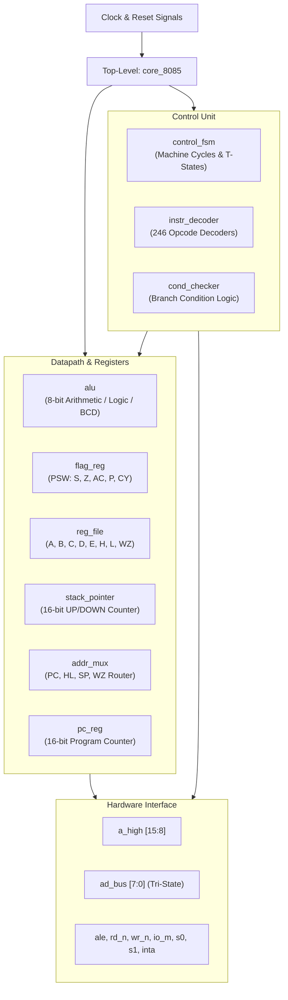

# 8085 Microprocessor RTL - Architecture Specification

This document details the microarchitecture, datapath design, timing sequencing, and hardware interface of the synthesizable Intel 8085 RTL core.

---

## 1. Top-Level Specifications

| Parameter | Specification |
| :--- | :--- |
| **Data Bus Width** | 8 bits (`AD0-AD7` bidirectional multiplexed) |
| **Address Bus Width** | 16 bits (`A8-A15` dedicated upper, `AD0-AD7` demultiplexed lower) |
| **Addressable Memory** | 64 KB linear space (`0x0000 - 0xFFFF`) |
| **I/O Ports** | 256 Input / 256 Output ports (`0x00 - 0xFF`) |
| **Instruction Set** | Complete 8085 ISA (all 246 valid opcodes) |
| **Architecture Type** | Multi-cycle CISC register-transfer logic |
| **HDL Standard** | Verilog-2001 (Fully Synthesizable) |

---

## 2. Block Diagram



---

## 3. Bus Multiplexing & Pinout Timing

The core faithfully reproduces the physical 40-pin packaging constraints of the Intel 8085:

### 3.1 Multiplexed Address/Data Bus (`AD0-AD7`)
* During **T1** of every machine cycle:
  * `ALE` (Address Latch Enable) is driven **HIGH**.
  * `ad_bus[7:0]` carries the lower 8 bits of the address (`A0-A7`).
  * External hardware (e.g. 74LS373 transparent latch) latches the address on the falling edge of `ALE`.
* During **T2 - T3** of every machine cycle:
  * `ALE` is driven **LOW**.
  * If a read cycle (`rd_n == 0`), `ad_bus` transitions to high-impedance (`8'hZZ`), allowing memory or I/O devices to drive data into the core.
  * If a write cycle (`wr_n == 0`), the core actively drives output data onto `ad_bus`.

### 3.2 Machine Status Lines
The status lines `io_m`, `s1`, and `s0` identify the active machine cycle in real hardware:

| Machine Cycle | `io_m` | `s1` | `s0` | Control Strobe | Purpose |
| :--- | :---: | :---: | :---: | :---: | :--- |
| **Opcode Fetch (`M_FETCH`)** | `0` | `1` | `1` | `rd_n = 0` (T2-T3) | Fetches opcode byte from memory |
| **Memory Read (`M_MEM_RD`)** | `0` | `1` | `0` | `rd_n = 0` (T2-T3) | Reads operand / data byte from memory |
| **Memory Write (`M_MEM_WR`)** | `0` | `0` | `1` | `wr_n = 0` (T2-T3) | Writes data byte to memory |
| **I/O Read (`M_IO_RD`)** | `1` | `1` | `0` | `rd_n = 0` (T2-T3) | Reads byte from peripheral input port |
| **I/O Write (`M_IO_WR`)** | `1` | `0` | `1` | `wr_n = 0` (T2-T3) | Writes byte to peripheral output port |
| **Interrupt Acknowledge (`M_INTA`)** | `1` | `1` | `1` | `inta = 1` | Acknowledges active interrupt vector |
| **Halt (`M_HALT`)** | `0` | `0` | `0` | None | Core stopped until unmasked reset/interrupt |

---

## 4. Control State Machine (`control_fsm.v`)

Instruction execution is governed by a synchronous, multi-cycle state machine sequenced by Machine Cycles (`m_cycle`) and Clock T-States (`t_state`).

### 4.1 T-State Sequencing
* Every standard machine cycle consists of 3 to 5 T-states:
  * **T1:** Driving address onto `a_high` and `ad_bus`; asserting `ALE`.
  * **T2:** Latching address in external latch; activating read (`rd_n`) or write (`wr_n`) strobes.
  * **T3:** Transferring data between memory/device and processor internal registers; clearing read/write strobes.
  * **T4:** Internal instruction decode and 8-bit / 16-bit ALU execution.
  * **T5:** Optional internal execution state (for `NOP`, `DAD`, etc.).

### 4.2 Branching & Subroutine Execution
* **Conditional Jumps (`JNZ`, `JZ`, etc.):**
  * When condition is met (`take_branch = 1`): Fetches 2-byte operand address into internal temporary registers `Z` and `W`; updates `PC <= {W, Z}` at end of cycle.
  * When condition is NOT met (`take_branch = 0`): Sequentially reads the two operand bytes to increment `PC <= PC + 2` past the 3-byte instruction without modifying execution flow.
* **Calls (`CALL`, `CC`, `CNC`, etc.):**
  * Reads destination address into `WZ`.
  * If condition is true: sequences through two `M_MEM_WR` cycles pushing `PC[15:8]` to `SP-1` and `PC[7:0]` to `SP-2`, decrements `SP`, and updates `PC <= WZ`.
* **Returns (`RET`, `RC`, `RNC`, etc.):**
  * If condition is true: sequences through two `M_MEM_RD` cycles popping low return address from `SP` and high return address from `SP+1`, increments `SP`, and updates `PC <= {high, low}`.

---

## 5. Datapath Units

### 5.1 Register File (`reg_file.v`)
Houses the primary user-accessible 8-bit registers and 16-bit register pairs:
* **Registers:** B (0), C (1), D (2), E (3), H (4), L (5), Memory pseudo-register (6), Accumulator A (7).
* **Pairs:** BC (`00`), DE (`01`), HL (`10`), and SP reference (`11`).
* **16-bit Pointer Arithmetic:** Native internal increment (`INX`), decrement (`DCX`), and double addition (`DAD`) executed in single cycles, with carry-out routed directly to the flag unit.
* **XCHG Logic:** Single-cycle hardware swap between pairs DE and HL.

### 5.2 Arithmetic Logic Unit (`alu.v`)
* **Operations:** `ADD`, `ADC`, `SUB`, `SBB`, `ANA`, `XRA`, `ORA`, `CMP`, `INR`, `DCR`, `CMA`, `STC`, `CMC`, `RLC`, `RRC`, `RAL`, `RAR`, and `DAA`.
* **BCD Adjustment (`DAA`):** Uses Auxiliary Carry (`AC`) and Carry (`CY`) flags to perform accurate decimal correction after binary addition.
* **Special Flags:** Standard 8085 logical `ANA` sets Auxiliary Carry (`AC = 1`), while `ORA`/`XRA` reset it to `0`.

### 5.3 Program Status Word (`flag_reg.v`)
Formats the latched status word according to official Intel 8085 specifications:
```
Bit:   7    6    5    4    3    2    1    0
PSW: [ S |  Z |  0 | AC |  0 |  P |  1 | CY ]
```
* **S (Sign):** Set if MSB of result is 1.
* **Z (Zero):** Set if result is `0x00`.
* **AC (Auxiliary Carry):** Carry from bit 3 to bit 4.
* **P (Parity):** Set if result has even parity.
* **CY (Carry):** Unsigned carry/borrow from bit 7.

### 5.4 Dedicated Stack Pointer (`stack_pointer.v`)
16-bit synchronous UP/DOWN counter initialized to `0xFFFF` on reset:
* Directly loadable via `LXI SP` (from `WZ`) and `SPHL` (from `HL`).
* Synchronously decrements on `PUSH` and `CALL`, increments on `POP` and `RET`.
* Directly indexable via `INX SP` and `DCX SP`.

---

## 6. Physical FPGA Implementation Metrics

The `core_8085` was synthesized directly using **AMD Vivado v2025.2** targeting the **Xilinx Artix-7 (`xc7a35tcpg236-1`)**:

| Resource | Count | Available | Utilization (%) | Notes |
| :--- | :--- | :--- | :--- | :--- |
| **Slice LUTs** | 958 | 20,800 | 4.61% | Logic cells for FSM, ALU, and decoders |
| **Slice Registers** | 141 | 41,600 | 0.34% | Internal architectural registers & state |
| **Bonded IOBs** | 26 | 106 | 24.53% | Authentic 8085 physical interface pins |
| **Latches** | 0 | 41,600 | 0.00% | 100% synchronous RTL; zero latch hazards |
| **Block RAM / DSP**| 0 | — | 0.00% | Synthesized entirely into distributed slices |
| **Critical Path Delay** | 13.942 ns | — | — | Longest combinatorial datapath |
| **Maximum Frequency ($F_{max}$)** | **~71.72 MHz** | — | — | **>14× faster than physical 5.0 MHz 8085A-2** |
